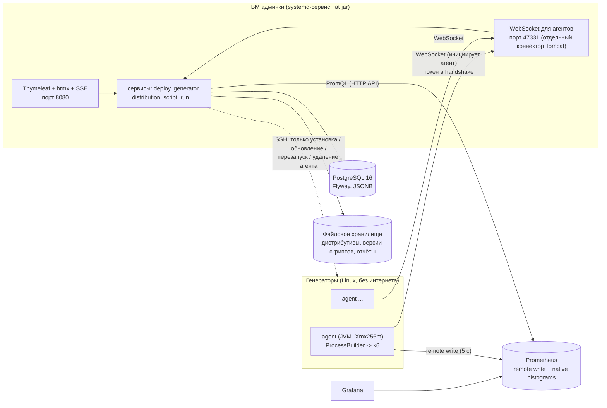

# k6-lab — админка распределённых нагрузочных тестов на k6

Внутренний инструмент команды нагрузочного тестирования: парк из ~20 Linux-генераторов, распределённый запуск
k6-сценариев (десятки тысяч RPS), live-мониторинг и анализ результатов по ступеням.

> **Статус:** реализованы все 8 этапов ТЗ: деплой агентов по SSH, скрипты и версии (upload/Git), модель нагрузки,
> профили, сценарии, распределённые запуски, live-мониторинг, результаты по ступеням, HTML/PDF-отчёты, сравнение запусков,
> аудит. Подробности по этапам — в разделах ниже; что осталось доработать — в конце README.

## Архитектура



Принципы:

* Агент сам подключается к серверу (WebSocket, raw JSON, polymorphic по полю `type`), поэтому генераторам не нужны
  входящие порты. Обрыв связи тест не прерывает: события буферизуются в дисковом журнале агента и досылаются после
  реконнекта; сервер обрабатывает их идемпотентно (у каждого события `seq`).
* SSH используется **только** для жизненного цикла агента. Тестами управляет WebSocket.
* Перцентили считаются **только** из native histograms Prometheus (`histogram_quantile`) — это корректная агрегация
  по всем генераторам (этап 6). Перцентили из summary/REST API k6 накопительные и показываются лишь справочно.

### Модули Maven

| Модуль | Назначение |
|---|---|
| `admin-core` | протокол агент↔сервер, генератор конфига k6, сегменты, ступени. Чистая логика без Spring |
| `admin-server` | приложение: Spring MVC + Thymeleaf + htmx, JPA, Flyway, Security, SSH (MINA SSHD), WebSocket |
| `agent-go` | **агент на генераторе (основной): Go, один статический бинарь ~10 МБ, без JRE на серверах** |
| `admin-agent` | прежний агент на Java (оставлен для совместимости и тестов протокола; на Go-агента переход без изменений на сервере) |
| `k6-helpers` | JS-модуль `admin.js`, который кладётся рядом со скриптом в `__admin/admin.js` |

## Установка админки на ВМ

Требования: Linux с systemd, Java 17+, PostgreSQL 16, свободные порты 8080 (UI) и 47331 (агенты).

```bash
# 1. База
sudo -u postgres psql -c "create user k6lab with password 'СЛОЖНЫЙ_ПАРОЛЬ'"
sudo -u postgres psql -c "create database k6lab owner k6lab"

# 2. Пользователь и каталоги
sudo useradd --system --home-dir /opt/k6-lab --shell /usr/sbin/nologin k6lab
sudo install -d -o k6lab -g k6lab /opt/k6-lab /var/lib/k6-lab/storage
sudo install -m 644 -o k6lab -g k6lab admin-server/target/k6-lab-admin.jar /opt/k6-lab/k6-lab-admin.jar

# 3. Секреты (файл с правами 600)
sudo tee /etc/k6-lab.env >/dev/null <<EOF
K6LAB_DB_URL=jdbc:postgresql://localhost:5432/k6lab
K6LAB_DB_USER=k6lab
K6LAB_DB_PASSWORD=СЛОЖНЫЙ_ПАРОЛЬ
K6LAB_MASTER_KEY=$(openssl rand -base64 32)
K6LAB_STORAGE_DIR=/var/lib/k6-lab/storage
K6LAB_AGENT_PORT=47331
EOF
sudo chmod 600 /etc/k6-lab.env && sudo chown root:root /etc/k6-lab.env
```

> **Мастер-ключ `K6LAB_MASTER_KEY` нужно сохранить отдельно** (менеджер паролей/секретов): им шифруются SSH-ключи,
> пароли и секреты сценариев в БД. Без него расшифровать их невозможно, а при смене ключа учётки придётся ввести заново.

```ini
# /etc/systemd/system/k6-lab.service
[Unit]
Description=k6-lab admin
After=network-online.target postgresql.service
Wants=network-online.target

[Service]
User=k6lab
WorkingDirectory=/opt/k6-lab
EnvironmentFile=/etc/k6-lab.env
ExecStart=/usr/bin/java -Xmx1g -jar /opt/k6-lab/k6-lab-admin.jar
Restart=always
RestartSec=5
SuccessExitStatus=143
LimitNOFILE=65536

[Install]
WantedBy=multi-user.target
```

```bash
sudo systemctl daemon-reload && sudo systemctl enable --now k6-lab
sudo journalctl -u k6-lab -f      # при первом запуске будет напечатан пароль администратора admin
```

Первый администратор `admin` создаётся при пустой БД. Пароль берётся из `K6LAB_ADMIN_PASSWORD`, а если переменная не
задана — генерируется и **один раз** пишется в журнал. Смените его в разделе «Пользователи».

Порт агентов (`K6LAB_AGENT_PORT`, по умолчанию 47331) слушает отдельный коннектор Tomcat: на нём доступны только
пути `/agent/**`, а UI и API с генераторов не видны (и наоборот: `/agent/**` не отвечает на порту UI).
Откройте этот порт в файрволе **с генераторов** на ВМ админки. Канал агентов — обычный `ws://`; если сеть недоверенная,
ограничьте порт файрволом (токены и секреты сценариев идут по этому каналу).

## Требования к Prometheus

* Запуск с `--web.enable-remote-write-receiver` — приём remote write от k6 (`experimental-prometheus-rw`).
* Запуск с `--enable-feature=native-histograms` — перцентили считаются только из native histograms.
  Агент запускает k6 с `K6_PROMETHEUS_RW_TREND_AS_NATIVE_HISTOGRAM=true` и push-интервалом 5 с.
* Генераторы должны видеть `http://prometheus:9090/api/v1/write`; админка читает `http://prometheus:9090/api/v1/query`.
* Имена метрик (с суффиксами единиц) вынесены в «Настройки → Имена метрик k6» (JSON) и проверяются кнопкой
  «Проверить» в блоке «Диагностика» (10-секундный smoke-тест на выбранном генераторе против `/actuator/health` админки,
  затем проверка, что метрики дошли до Prometheus и `histogram_quantile` возвращает значение). Без успешной диагностики
  для текущих URL/аутентификации запуск тестов недоступен (отключается `K6LAB_REQUIRE_DIAGNOSTICS=false`, только для
  разработки). Для диагностики задайте `K6LAB_PUBLIC_URL` — адрес UI админки, доступный с генераторов.
* Параметры Prometheus (URL remote write, URL запросов, Basic/Bearer, шаблон ссылки на Grafana) задаются в
  «Настройки → Prometheus» или начальными значениями `K6LAB_PROMETHEUS_RW_URL`, `K6LAB_PROMETHEUS_QUERY_URL`.

## Деплой генераторов (этап 1)

1. **Дистрибутивы** (ADMIN): загрузите jar агента (`admin-agent/target/k6-agent.jar`), бинарь k6 для `linux-amd64`/
   `linux-arm64`, архив JRE 21 `tar.gz` (только если ставите Java-агента) и при необходимости xk6-сборки. Первая версия каждого
   вида автоматически становится версией по умолчанию. У генераторов нет интернета — всё доставляется по SFTP,
   sha256 проверяется на хосте.
2. **SSH-учётки** (ADMIN): пользователь, ключ или пароль, passphrase, пароль sudo, jump-host. Секреты шифруются
   AES-GCM и после сохранения не показываются. Пароль sudo передаётся только через stdin (`sudo -S`).
3. **Генераторы → Добавить**: «Проверить подключение» выполняет только pre-flight. При первом подключении к хосту
   показывается fingerprint ключа — его нужно подтвердить; при несовпадении с сохранённым установка прерывается.
4. Установка идёт асинхронно, вывод по шагам стримится в UI. Pre-flight проверяет архитектуру/ОС/systemd, sudo,
   linger, место на диске, доступность порта агентов с генератора и расхождение часов (> 500 мс — предупреждение,
   > 2 с — ошибка, рекомендация настроить chrony).

Режимы: **системный** (пользователь `k6agent`, unit в `/etc/systemd/system`, `Restart=always`,
`LimitNOFILE=1048576`, опциональный sysctl-тюнинг) и **пользовательский** (каталог в домашнем; `systemctl --user`, если
включён linger, иначе cron-супервизор: `@reboot` + watchdog раз в минуту — менее надёжно, UI предупреждает).
Если шаг 6 или позже (запуск сервиса, ожидание регистрации) не удался — выполняется откат.

## Контракт скрипта и helper-модуль `admin.js` (этап 2)

* Одна операция = одна экспортируемая функция.
* В скрипте **нельзя** объявлять `options.scenarios/stages/vus/duration/iterations`: опции скрипта имеют приоритет над
  `--config` и перекрыли бы модель из UI. Версия с такими опциями помечается непригодной для запуска через модель.
* В открытой модели в операции нет `sleep` для регулировки нагрузки.
* Админка кладёт `__admin/admin.js` рядом с entrypoint (модуль можно скачать из UI для локальной разработки).

API `admin.js`:

| Экспорт | Что делает |
|---|---|
| `op(fn)` | выполняет операцию; пишет длительность `fn` (без pacing) в Trend `op_duration`; неуспех (исключение, `fail()` или проваленный `check`) — в Rate `op_failed` и Counter `op_errors`; затем применяет pacing из `__ENV.PACING_MS` (досыпает до конца периода; если `fn` уже дольше — ничего не делает) |
| `check(val, sets, tags)` | drop-in замена `check` из `k6`: считает провалы для `op` |

> **Важно:** k6 не позволяет скрипту читать значения метрик, а обычный `check` из `'k6'` прозрачно не перехватить
> (импорт — неизменяемая привязка; проверено на k6 1.7.1). Поэтому внутри `op()` проваленные проверки учитываются только
> для `check`, импортированного из `admin.js`. Исключения и `fail()` ловятся всегда.
> Дополнительно `admin.js` ведёт счётчики `op_count` и `op_errors`: Rate нельзя корректно агрегировать между
> генераторами, а процент ошибок по всему парку считается как `sum(op_errors) / sum(op_count)`.

```js
import http from 'k6/http';
import { fail } from 'k6';
import { op, check } from './__admin/admin.js';

// Профиль нагрузки здесь НЕ объявляется (нет options.scenarios/stages/vus/duration/iterations).

export function createPayment() {
    op(() => {
        const res = http.post(`${__ENV.BASE_URL}/api/payments`, JSON.stringify({ amount: 100 }),
            { headers: { 'Content-Type': 'application/json' }, tags: { name: 'POST /api/payments' } });
        check(res, { 'status is 201': (r) => r.status === 201 });
    });
}

export function getPayment() {
    op(() => {
        const res = http.get(`${__ENV.BASE_URL}/api/payments/42`, { tags: { name: 'GET /api/payments/{id}' } });
        if (res.status >= 500) {
            fail(`server error ${res.status}`);
        }
    });
}
```

Метрики SLA операции: `op_duration{scenario:<операция>}` и `op_failed`, если скрипт использует helper; иначе
`iteration_duration{scenario:<операция>}` и `http_req_failed`/`checks`. Закрытая модель без helper запрещена
(pacing попал бы во время операции). Для запросов с динамическими URL ставьте тег `name` — иначе вырастет кардинальность.

## Запуск теста, мониторинг и результаты (этапы 4–8)

1. **Тесты → Скрипты / Git-репозитории**: загрузка zip/файла или Git (ветка/тег/commit, версии, diff, Monaco). Скрипт не
   изменяется: админка добавляет только `__admin/admin.js` рядом и режет файлы данных в режиме SPLIT.
2. **Модели нагрузки, профили, сценарии**: интенсивность операций (оп/с, оп/мин, оп/час, доли), профили
   (поиск максимума, стресс, подтверждение, надёжность, всплеск, произвольный, шаблоны). Сценарий связывает скрипт, модель,
   профиль, env/секреты, SUT и критерии остановки. Предпросмотр показывает ступени, итоговый конфиг k6 и графики.
3. **Запуски → Новый запуск**: выбор генераторов с весами (или пул), политика отвала генератора (продолжать/остановить
   всех). Run ставится в очередь и стартует, когда нужные генераторы свободны. Старт синхронный: сервер учитывает
   смещение часов каждого агента и отказывает при расхождении > 500 мс.
4. **Live-страница run**: статус и генераторы (CPU > 80% подсвечивается), вкладка «Метрики» (интенсивность факт/план,
   перцентиль SLA, ошибки, метрики SUT; обновление каждые 5 с одним опросом Prometheus на run), логи с фильтрами и
   поиском (SSE), кнопки Стоп/Прервать/пауза/масштаб (пауза и масштаб — только для `externally-controlled`).
   Критерии остановки (перцентиль > N×SLA, ошибки, интенсивность, dropped) вычисляет сервер — не k6 (`abortOnFail` не
   используется) — только на удержании после выхода на режим и после N подряд нарушений.
5. **Результаты** (вкладка в run): таблица «ступень × операция» (план/факт, p50/p90/p95/p99, ошибки, dropped,
   метрики SUT avg/max/last), статус каждой ступени, кандидат максимума (**последняя успешная ступень перед первой
   неуспешной**), вывод инженера, пометка эталона, кнопка «Создать подтверждение максимума» (копия сценария с
   профилем CONFIRMATION на найденном уровне). Ступень считается недостоверной, если генератор отваливался во время
   удержания; ступень при перегрузке генераторов (CPU > порога) — неуспешной с пометкой.
6. **Отчёты**: самодостаточный HTML и PDF из одного шаблона (графики XChart встроены, шрифт DejaVu).
7. **Сравнение** (`Запуски → выбрать A и B → Сравнить`): ступени сопоставляются по уровню, показывается разница
   времени/интенсивности/ошибок; ухудшение > 10% подсвечивается. У сценария может быть один эталонный run — при открытии
   результатов нового run автоматически показывается сравнение с ним.
8. **Настройки / Аудит** (ADMIN): Prometheus, диагностика, имена метрик, лимит строк лога агента, сроки хранения;
   журнал действий.

Хранение: логи run — секционированная таблица (30 дней, удаление секции целиком), метрики генераторов — 7 дней,
результаты и отчёты — без ограничения.

## Портативная версия (без Docker, для виртуалок)

Комплект собирается **одной командой** и содержит всё, кроме PostgreSQL и Prometheus. Нужны JDK 17+, Go 1.22+, curl и tar
(на Windows — Git for Windows: его bash). xk6 ставится автоматически.

```bash
./build.sh                  # Linux / macOS / Git Bash;  Windows: build.cmd
./build.sh --with-tests     # сначала прогнать все тесты
./build.sh --no-xk6         # без k6 с расширениями (быстрее)
./build.sh --check          # только проверить, что всё необходимое установлено
./build.sh --k6-dir ДИР --xk6-dir ДИР2   # взять готовые k6 / k6 с расширениями из каталогов, ничего не скачивая
```

**Работа в изолированной сети.** Готовый архив самодостаточен: интерфейс (Bootstrap, иконки, Chart.js, Monaco, diff2html,
типы k6) лежит внутри jar и не обращается к CDN, агент и k6 доставляются на генераторы с сервера админки по SFTP, k6 на
генераторах запускается с отключённой докачкой расширений. Интернет нужен только на машине, где собирается архив
(Maven, Go-модули, k6); для полностью офлайн-сборки используйте `--k6-dir/--xk6-dir` и локальные кеши Maven и Go.

Результат — `portable/k6-lab-portable.zip` (~200 МБ). Админка собирается под **Java 17** (запускается на 17 и новее, проверено
на Temurin 17); агентам на генераторах Java не нужна.

В архиве: `k6-lab-admin.jar`, `start.bat` / `start.sh`, `dist/` с агентом на Go (linux-amd64/arm64, без JRE), k6
(linux-amd64/arm64) и сборкой k6 с популярными расширениями xk6 («full»: kafka, sql + драйверы postgres/mysql, faker, mqtt, sse).

1. Распакуйте, запустите `start.bat` / `./start.sh` (нужна Java 17+ на машине админки).
2. Откройте http://localhost:8080 — мастер первого запуска спросит параметры PostgreSQL, проверит подключение, сохранит их
   и сгенерирует ключ шифрования в `config/k6lab.properties` (**сохраните файл**) и пароль `admin`.
3. Дистрибутивы из `dist/` подхватываются сами (`dist/manifest.json`), второй запуск ничего не дублирует.
4. «Генераторы → Добавить сервер» (адрес, логин, пароль SSH) → «Тесты → Создать тест» → «Запустить».
5. «Ещё → Настройки»: адреса Prometheus и «Проверить» (без этого запуск тестов заблокирован).

Версии расширений xk6 закреплены: свежие релизы расширений собраны под k6 v2 и в бинаре k6 1.x молча не регистрируются.
У генераторов нет интернета, поэтому агент запускает k6 с `K6_AUTO_EXTENSION_RESOLUTION=false`.
Для проверки без Docker: тесты `*IT` сами используют встроенный PostgreSQL (zonky), если Docker недоступен;
`ru.k6lab.server.dev.DevPostgres` поднимает такую базу для ручной работы.

## Агент на Go

`agent-go/` — полная замена Java-агента с тем же протоколом (WebSocket/JSON, журнал событий с seq и ACK, PING/PONG для часов,
PREPARE/START/STOP/ABORT/PAUSE/RESUME/SCALE, SPLIT данных, маскирование секретов, лимит строк лога, метрики из `/proc`).
Собирается `CGO_ENABLED=0 GOOS=linux GOARCH=amd64|arm64 go build` в один бинарь; на генератор доставляется как
`k6-agent` (SSH-деплой сам определяет бинарь по имени файла дистрибутива, JRE не ставится и не нужна).
Тесты: `cd agent-go && go test ./...`; серверные E2E (`RunE2EIT`) по умолчанию запускают Go-агента с настоящим k6
(`-Dk6lab.it.agent=java` — Java-агента). Обновление уже установленного Java-агента на Go: удалить и поставить заново.

## Разработка

```bash
./mvnw verify                               # (Maven Wrapper 3.9.x) юнит-тесты + интеграционные (Docker: Testcontainers)
./mvnw -pl admin-agent,admin-server -am verify # то же без k6-helpers
k6 run k6-helpers/test/helper-smoke.js      # проверка admin.js локальным k6
```

Интеграционные тесты (`*IT`) выполняются плагином failsafe:

* `WebSecurityIT`, `AgentProtocolIT` — PostgreSQL 16 в Testcontainers, реальный порт агентов;
* `ScriptIT`, `ScenarioIT` — скрипты/версии/Git, модель, профили, сценарии, превью и конфиг;
* `RunE2EIT` — сервер + настоящие процессы агента + настоящий k6: запуск, SPLIT, стоп/abort, очередь, отвал генератора,
  падение k6, диагностика Prometheus (нужны собранный агент и `k6` в PATH, иначе пропускается);
* `ResultsIT` — итоги по ступеням, максимум, сравнение, отчёты HTML/PDF (Prometheus подменён заглушкой);
* `SshDeployIT` — контейнер Debian 12 с systemd и sshd (нужны Docker с поддержкой privileged-контейнеров, собранный
  агент и интернет для скачивания JRE 21; кеш — `admin-server/target/it-cache`). Без этого тест пропускается.
  Если зеркало Debian нестабильно: `DEBIAN_MIRROR=ftp.de.debian.org ./mvnw verify`.

### docker-compose (только для разработки)

```bash
./mvnw -DskipTests package
docker compose up -d --build
```

| Сервис | Адрес |
|---|---|
| Админка | http://localhost:8080 (`admin` / `admin12345`) |
| Агенты → админка | `ws://app:47331/agent/ws` (из контейнеров), `ws://host.docker.internal:47331/agent/ws` (с хоста) |
| PostgreSQL | `localhost:5432` (`k6lab`/`k6lab`) |
| Prometheus (native histograms + remote write receiver) | http://localhost:9090 |
| Grafana | http://localhost:3000 |
| `gen1`, `gen2` — Debian + systemd + sshd | SSH `localhost:2201` / `localhost:2202`; `deploy`/`deploy` (sudo с паролем), `k6user`/`k6user` (без sudo, режим пользовательский) |

Для проверки SSH-деплоя в compose: создайте SSH-учётку `deploy`/`deploy` (пароль sudo `deploy`), загрузите
дистрибутивы и добавьте генератор с хостом `gen1`, портом SSH `22` и URL сервера `ws://app:47331/agent/ws`.

## Что осталось доработать

* TLS на порту агентов (сейчас `ws://`, закрывайте файрволом).
* Графики вкладки «Метрики» накапливаются в браузере с момента открытия страницы (история до этого — в Grafana по ссылке).
* Загрузка архива в качестве дистрибутива k6/xk6 не поддерживается — нужен сам исполняемый файл.
* Сравнение более двух run и экспорт сравнения в отчёт.
